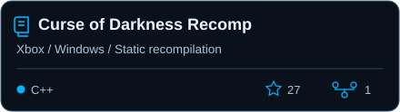
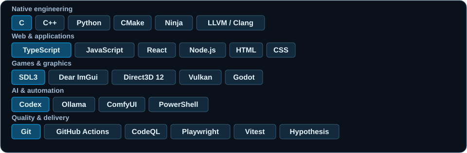
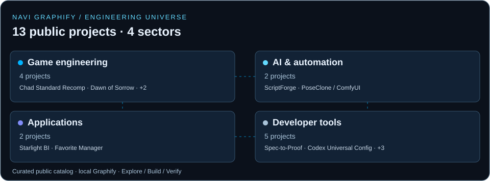

<div align="center">
  
  <h1>NAVI // GitHub Homepage</h1>
  <p>Engineering identity, profile intelligence and interactive project discovery.</p>
  <a href="https://github.com/Neguchads/navi-githomepage/actions"></a>
  <a href="LICENSE">MIT</a> · <a href="docs/readme_pt-BR.md">Português</a> · <a href="https://github.com/Neguchads">Neguchads</a>
</div>

## 01 / Identity

NAVI GitHub Homepage is the open-source visual and publishing layer of the Neguchads engineering ecosystem. It combines reusable SVG cards, an offline project explorer and a graph-backed engineering universe.

| Component | Responsibility |
| --- | --- |
| [NAVI Core](https://github.com/Neguchads/navi-core) | Agent-independent governance and verification |
| [NAVI Graphify](https://github.com/Neguchads/navi-graphify) | Reviewed public graph snapshots |
| [NAVI Abyss](https://github.com/Neguchads/navi-abyss) | Optional immersive visual experience |
| [Neguchads profile](https://github.com/Neguchads/Neguchads) | Public publishing surface |

## 02 / Visual system







[Brand guide](docs/neguchads/README.md) · [Offline explorer](docs/explore/README.md) · [Download standalone HTML](https://raw.githubusercontent.com/Neguchads/navi-githomepage/main/docs/explore/index.html) · [Universe renderer](docs/universe/README.md)

The samples are checked-in assets, not live telemetry. Use `neguchads` or `neguchads_light` for the NAVI palette; existing theme names and API routes remain compatible.

## 03 / Develop and verify

Use Node.js 22 for the primary development workflow (the package retains its existing Node >=18 engine declaration).

```sh
npm ci --ignore-scripts
npm run test:brand
npm run verify:portfolio
npm test -- --runInBand
```

Open `docs/explore/index.html` directly in a modern browser. The full Universe bundle is built from reviewed inputs; see its documentation. No live deployment is assumed.

## 04 / Card API

Self-host this repository to use the SVG endpoints. See [API and deployment](docs/API.md) for supported options and privacy boundaries. Do not give a public endpoint a token with private-repository access.

## 05 / Engineering governance

[Architecture](docs/ARCHITECTURE.md) · [Roadmap](docs/ROADMAP.md) · [Handoff](docs/HANDOFF.md) · [Decisions](docs/DECISIONS.md) · [Testing](docs/TESTING.md) · [NAVI pilot](docs/NAVI_PILOT.md)

Changes follow the [NAVI Engineering Framework](https://github.com/Neguchads/navi-core/blob/main/docs/NEF.md): project-specific architecture, evidence-first verification, explicit public data provenance and reviewed publication.

## 06 / Contribute

[Contributing](CONTRIBUTING.md) · [Security](SECURITY.md) · [Issues](https://github.com/Neguchads/navi-githomepage/issues) · [Changelog](CHANGELOG.md)

---

## Credits and license

Maintained by Neguchads. Based on [Beautiful GitHub Homepage](https://github.com/ishandutta2007/beautiful-github-homepage) by Ishan Dutta and [GitHub Readme Stats](https://github.com/anuraghazra/github-readme-stats) by Anurag Hazra and contributors. Full [credits](CREDITS.md) and original [MIT license](LICENSE) are retained.

[Open-source credits, provenance and distribution review](docs/OPEN_SOURCE_COMPLIANCE.md).
