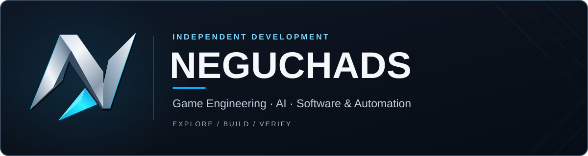
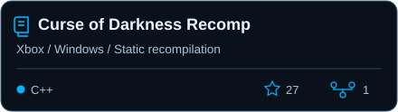
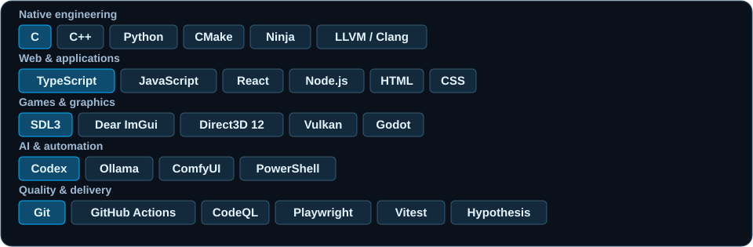

# Neguchads edition



The native NAVI visual system for reusable GitHub cards. See [credits and license](../../CREDITS.md).

## Brand themes

| Parameter | `neguchads` | `neguchads_light` |
| --- | --- | --- |
| Background | #0B111B | #FFFFFF |
| Title | #EAF4FF | #152B40 |
| Body | #C8D7E6 | #263B50 |
| Accent | #00B3FF | #007EAF |
| Border | #34516A | #CAD9E5 |
| Rank ring | #63DAFF | #006E9F |

Both themes are registered with the existing card engine. Existing themes and endpoint defaults are unchanged.

## Examples





These are local static design examples, not live API responses. The project card contains only public repository information.

## Use your own deployment

Replace YOUR_DEPLOYMENT with the URL of a deployed instance of **this repository**, not the a third-party public service. No deployment is provisioned by this change.

```text
https://YOUR_DEPLOYMENT/api?username=Neguchads&theme=neguchads&show_icons=true&hide_rank=true&show=prs_merged&disable_animations=true
https://YOUR_DEPLOYMENT/api/top-langs?username=Neguchads&theme=neguchads&layout=donut&langs_count=8
https://YOUR_DEPLOYMENT/api/pin?username=Neguchads&repo=ccod-xbox-recomp&theme=neguchads
```

Use the same options with `theme=neguchads_light` inside a GitHub `picture` element for light mode. For the Brazilian Portuguese version use the renderer's existing locale parameter where supported.

## Privacy and integration

The live [Neguchads profile](https://github.com/Neguchads/Neguchads) uses its own self-hosted SVG cards. Public showcase cards refresh through GitHub Actions; private-inclusive aggregate cards are generated locally using the authenticated GitHub CLI. See [profile analytics methodology](https://github.com/Neguchads/Neguchads/blob/main/docs/PROFILE_ANALYTICS.md).

Do not deploy this public API with a token that can read private repositories. The card engine was designed to render statistics from token-accessible data; this theme extension is not an authorization or privacy audit. Use the separate local aggregate workflow for private-inclusive statistics, review outputs before committing, and never publish credentials or private repository identifiers. Do not interpret language percentages as a developer proficiency rating.

## Validate

```sh
node --test tests/brand/neguchads-theme.mjs
npm ci
npm run test -- --runInBand tests/renderStatsCard.test.js tests/renderRepoCard.test.js tests/renderTopLanguagesCard.test.js
```

The first command uses Node's built-in test runner without installing dependencies. The existing Jest rendering tests exercise all registered themes.

