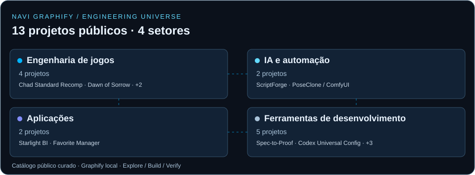

# NAVI // GitHub Homepage

[English](../README.md)

Camada visual do ecossistema Neguchads: cartões SVG, catálogo de projetos offline e universo interativo baseado em dados públicos revisados.

- [Identidade visual](neguchads/README.md)
- [Explorador offline](explore/README.md)
- [Universo NAVI](universe/README.md)
- [API e implantação](API.md)
- [Arquitetura](ARCHITECTURE.md) · [Roadmap](ROADMAP.md) · [Handoff](HANDOFF.md)
- [NAVI Core](https://github.com/Neguchads/navi-core) · [NAVI Graphify](https://github.com/Neguchads/navi-graphify)

## Desenvolvimento

Com Node.js 22, execute `npm ci --ignore-scripts`, `npm run test:brand`, `npm run verify:portfolio` e `npm test -- --runInBand`. Abra `explore/index.html` no navegador. Nenhuma implantação pública é presumida.

Use os temas `neguchads` ou `neguchads_light`. Nunca utilize credenciais com acesso a repositórios privados numa API pública.

## Créditos

[Créditos e proveniência](../CREDITS.md) · [Licença MIT](../LICENSE).
